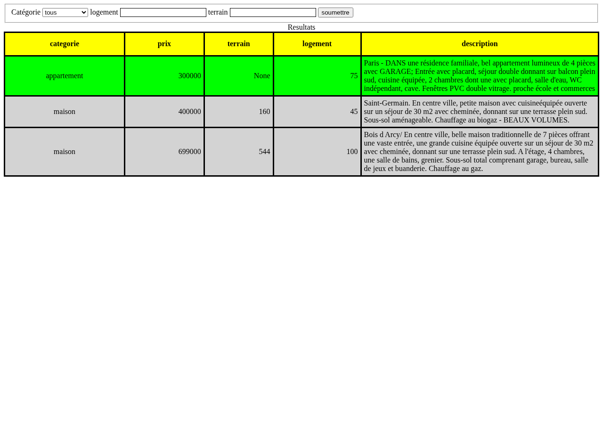
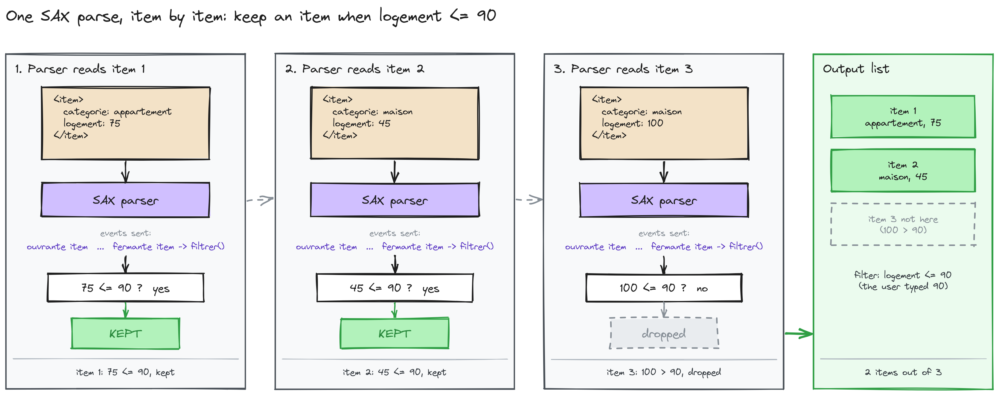

# client-server-architecture

Practical work for a client-server architecture course (Sorbonne University): small PHP and JavaScript programs that show how a browser and a server talk, how XML is read as a stream, and how a mail client speaks SMTP over a socket.

| | |
| --- | --- |
| **What** | Five small web and network exercises, each runnable in a browser or from the command line. |
| **For** | Anyone who wants to see the browser–server exchange, SAX parsing, AJAX and SMTP in working code. |
| **Stack** | PHP 8.5 (CLI and built-in server), HTML, JavaScript (XMLHttpRequest), XML with SAX, SMTP over sockets, iCalendar (`.ics`). |
| **Verified** | All 35 PHP files pass `php -l`. A search on the real-estate page returns the rows I counted by hand. The SMTP simulator completes a session and writes the message to a mailbox file. |



## Run it

You need PHP 8.5. Only that version was tested.

```sh
php -d display_errors=0 -S 127.0.0.1:8080 -t .
```

Then open:

- `http://127.0.0.1:8080/real-estate-agency/immobilier.html`: a search form that updates the results with AJAX, without reloading the page.
- `http://127.0.0.1:8080/shop-catalogue/MainPage.php`: a product catalogue with category and search.
- `http://127.0.0.1:8080/exercises/index.html`: a placeholder page with headings, lists and a table, used as a starting point for the HTML exercise.

To run the SMTP simulator, which accepts a session on a local port and writes each message to `/tmp/<name>.mbox`:

```sh
php smtp-mail-client/boucleSMTP.php 5225
```

## What is here

| Folder | What it does | How it works |
| --- | --- | --- |
| `real-estate-agency/` | A search over a listings file. | The form sends a POST in the background (`ajax.js`). The server reads `immobilier.xml` with a SAX parser and keeps the matching listings (`filtrer.php`). |
| `shop-catalogue/` | A product catalogue with categories and search. | Reads the product XML with a SAX parser (`Lancer_Phraseur.php`) and renders the rows with PHP. |
| `smtp-mail-client/` | A mail client and a local SMTP simulator. | The client talks to the simulator in text lines and reply codes. The simulator writes each message to an mbox file. |
| `exercises/` | Exercises: calendar merging, CGI examples and a placeholder HTML page. | `calendar-ics/` merges two `.ics` calendars. `cgi-scripts/` holds one script that prints the date and one that prints an HTML page. |



*A search with logement ≤ 90 keeps 2 of the 3 listings. The parser decides each item when its closing tag arrives.*

Diagrams of the other two mechanisms are in `docs/assets/diagrams/`: the AJAX search flow (`ajax-live-search.png`) and an SMTP session (`smtp-session.png`).

## Known issues

- `exercises/calendar-ics/fusion_ics.php`: the function `etes_vous_libre()` is unfinished pseudo-code. It is commented out, so the file parses, but the function is not available.
- `exercises/` contains two versions of one page (`fichier_retour.html` and `fichier_retour_originale.html`). Which one is the reference has not been decided.
- `smtp-mail-client/smtp.php` sends a hard-coded message when it runs. Change the message and the sender before using it.
- The data files (`real-estate-agency/immobilier.xml`, `exercises/calendar-ics/*.ics`, `smtp-mail-client/carnet.xml`) hold personal contact details of other people. They will be replaced with fictional addresses once that is decided.

## Tests

There are no unit tests. The workflow `.github/workflows/lint.yml` runs `php -l` on every tracked PHP file on each push and pull request. It has not run on GitHub yet.
